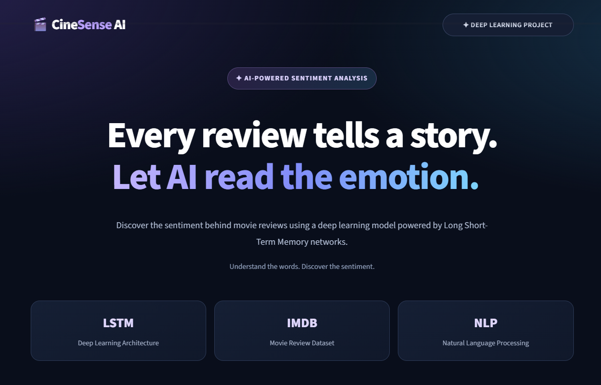
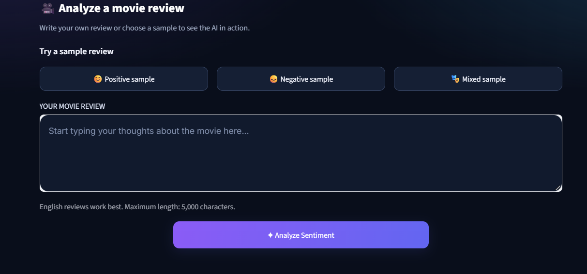
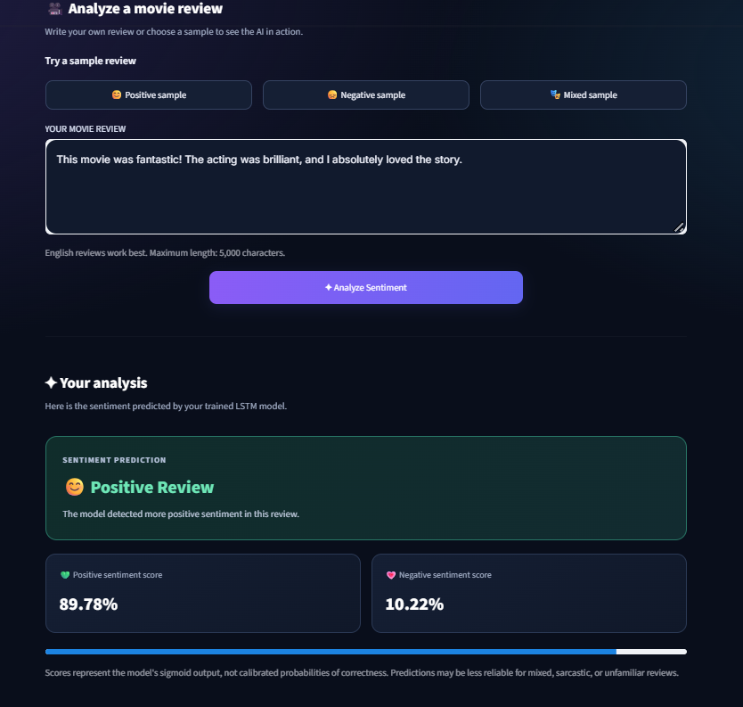
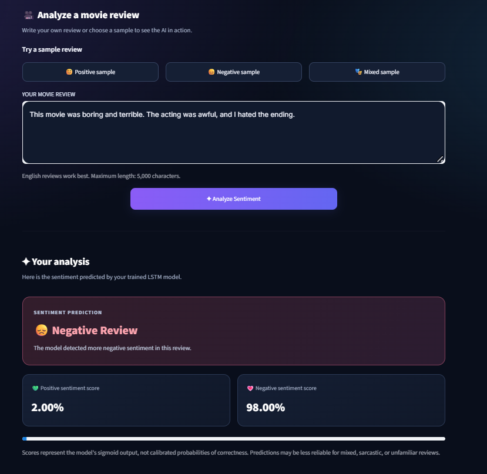
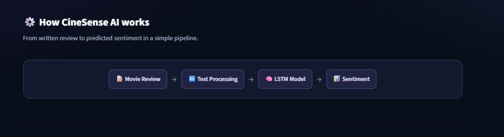
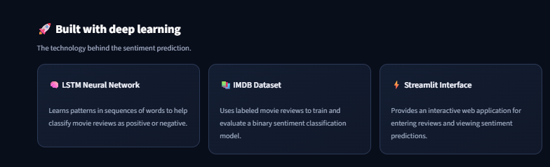

# 🎬 CineSense AI — Movie Review Classification Using LSTM

## ✨ Features

- Analyze custom movie reviews.
- Try sample positive, negative, and mixed reviews.
- View predicted sentiment and positive/negative scores.
- Interactive web interface built with Streamlit.
- Trained using the IMDB movie review dataset.

## 🧠 Technologies Used

- Python
- TensorFlow and Keras
- LSTM Neural Network
- Natural Language Processing (NLP)
- Streamlit
- NumPy

## ⚙️ How It Works

1. Enter a movie review or select a sample.
2. The application converts the text into numerical sequences.
3. The trained LSTM model analyzes the review.
4. The application displays the predicted sentiment and scores.

## 📁 Project Structure

```text
Movie_Review_LSTM/
├── app.py
├── train_model.py
├── requirements.txt
├── .gitignore
└── artifacts/
    ├── movie_review_lstm.keras
    └── word_index.pkl
```

## 🚀 Run Locally

1. Clone this repository:

   ```bash
   git clone https://github.com/RakshitaMahesh/CineSense-AI-Movie-Review-Classification.git
   ```

2. Open the project folder:

   ```bash
   cd CineSense-AI-Movie-Review-Classification
   ```

3. Create and activate a virtual environment:

   ```bash
   python -m venv venv
   ```

   On Windows:

   ```bash
   venv\Scripts\activate
   ```

4. Install the dependencies:

   ```bash
   pip install -r requirements.txt
   ```

5. Start the application:

   ```bash
   streamlit run app.py
   ```

## 📊 Model Performance

The trained LSTM model achieved approximately **84.43% test accuracy** during the project run. Actual predictions can vary depending on the review text.

## 🎯 Project Objective

To demonstrate how deep learning and natural language processing can be used to classify the sentiment expressed in movie reviews.

---

## 📸 Application Screenshots

### 1. CineSense AI Homepage


### 2. Movie Review Input


### 3. Positive Sentiment Prediction


### 4. Negative Sentiment Prediction


### 5. How CineSense AI Works


### 6. Technologies Used


---

## 🚀 Live Demo

[**Launch CineSense AI**](https://cinesense-ai-movie-review-classification-w9jalgsw9vgb6pdnc6cyc.streamlit.app/)

## 👩‍💻 Author

**Rakshita Mahesh**

Deep Learning Mini Project — Movie Review Classification Using LSTM
